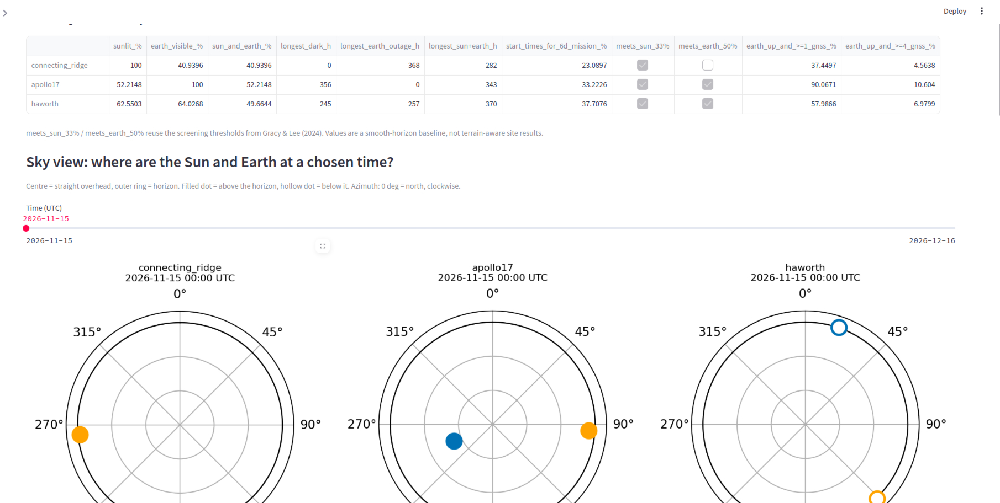

#  LuGRE landing navigation site

**NASA Space Apps Challenge 2026 – challenge: "Lunar Landing Site Navigator"**
Demo: [[LINK](https://lugre-landing-navigation-site.streamlit.app/))] · Repo: [[LINK](https://github.com/starAwesome123/Lunar_Navigator.git)] . materials: [[LINK](https://drive.google.com/drive/folders/1R1vxo8LCm3E1K6C-qfs0bJU4CyhXk20T))] . 


A small web app that lets a mission planner, student or curious member of the public **compare lunar landing sites and dates** by where the Sun and Earth sit relative to the horizon, and adds one question most tools do not answer:

> *When could a lander at this site both see Earth (power and direct-to-Earth link) and be reached by Earth's own GPS/Galileo signals?*

 

## What it does

- **Site and date comparison.** Pick sites and a date range; a side-by-side table shows sunlit share, Earth-visible share, time with both up, longest dark period, longest Earth outage, longest Sun+Earth window, and the share of possible arrival times that allow an N-day surface stay (default 6 days).
- **Sky view with a time slider.** A dial shows the Sun and Earth positions relative to the horizon at a chosen time, plus countdowns to sunset/sunrise and Earthset/Earthrise.
- **Timelines** of Sun and Earth elevation per site.
- **GNSS layer.** Shades the periods when Earth is above the horizon *and* at least one GPS/Galileo satellite is geometrically placed to send a signal toward the Moon.
- **Screening flags** using the thresholds from a published Artemis III site study (solar illumination ≥ 33 %, direct-to-Earth visibility ≥ 50 %).

## Sites

| Site | Lat (°) | East lon (°) | Source |
|---|---|---|---|
| apollo11_check | 0.67416 | 23.47314 | Apollo 11 Lunar Module, used as a sanity check (Wagner et al. 2017)|
apollo 17 |	20.1911 |	30.7723 | Apollo 17 Lunar Module (Wagner et al. 2017)
| connecting_ridge | -89.53432 | 209.94767 | Proposed landing site, Gracy & Lee 2024 |
| peak_near_shackleton | -89.01701 | 126.27302 | Proposed landing site, Gracy & Lee 2024 |
| nobile_rim_1 | -85.54419 | 37.6266 | Landing site, Chen et al. 2024, Table 1 |
| haworth | -86.80402 | 338.3329 | Landing site, Chen et al. 2024, Table 1 |

The region names are NASA's Artemis III candidate landing regions; the exact coordinates are **research proposals from a student poster and a conference paper** [`sites.csv`.]

## How it works

1. **Sun and Earth geometry.** `fetch_horizons.py` queries the JPL Horizons API for the Sun's and Earth's azimuth and elevation as seen from each surface point, hourly, over [2026-11-15 to 2026-12-16 UTC]. Results are cached as CSV files in `data/`.
2. **Metrics.** `metrics.py` turns the time series into the comparison numbers (shares of time, longest unbroken runs, N-day mission windows).
3. **GNSS layer.** `gnss_layer.py` loads current GPS and Galileo orbital elements (CelesTrak), propagates them with SGP4 (skyfield), and takes the Moon's position from the DE421 ephemeris. For each hour, a satellite counts as *usable* if (a) the line from the satellite to the Moon does not pass through Earth and (b) the angle between the satellite's Earth-pointing axis and the direction to the Moon is within an assumed main-lobe limit (**23.5°** by default). The receiver is placed at the Moon's centre; a lunar site is only about 1,700 km off-centre, a tiny angle at 384,000 km.
4. **App.** `app.py` (Streamlit) combines everything. `report.py` generates the tables used below.

## Results

| site | sunlit_% | earth_visible_% | sun_and_earth_% | longest_dark_h | longest_earth_outage_h | longest_sun+earth_h | start_times_for_6d_mission_% | meets_sun_33% | meets_earth_50% | earth_up_and_>=1_gnss_% | earth_up_and_>=4_gnss_% |
|---|---|---|---|---|---|---|---|---|---|---|---|
| apollo11_check | 52.1 | 100.0 | 52.1 | 355.0 | 0.0 | 356.0 | 35.4 | True | True | 90.1 | 10.6 |
| connecting_ridge | 100.0 | 40.9 | 40.9 | 0.0 | 368.0 | 282.0 | 23.1 | True | False | 37.4 | 4.6 |
| peak_near_shackleton | 100.0 | 39.7 | 39.7 | 0.0 | 373.0 | 277.0 | 22.3 | True | False | 36.4 | 4.6 |
| nobile_rim_1 | 62.3 | 68.5 | 61.2 | 281.0 | 231.0 | 364.0 | 36.7 | True | True | 61.9 | 7.5 |
| haworth | 62.6 | 64.0 | 49.7 | 245.0 | 257.0 | 370.0 | 37.7 | True | True | 58.0 | 7.0 |
| apollo17 | 52.2 | 100.0 | 52.2 | 356.0 | 0.0 | 343.0 | 33.2 | True | True | 90.1 | 10.6 |


**Sensitivity to the main-lobe angle** (20°, 23.5°, 26°):

| cone_deg | max_usable_sats | mean_usable_sats | hours_with_>=1_% | hours_with_>=4_% |
|---|---|---|---|---|
| 20 | 4.0 | 1.17 | 76.9 | 1.3 |
| 23.5 | 6.0 | 1.95 | 90.1 | 10.6 |
| 26 | 7.0 | 2.61 | 95.4 | 24.4 |

## Limitations (please read)

- **No terrain.** Horizons gives elevation above a *smooth* lunar sphere. At the poles, crater rims and ridges dominate real sunlight and Earth visibility, so every sunlit and Earth-visible share here is a baseline, not a site-specific prediction. The challenge suggests LOLA topography for accurate horizons; this is the main next step.
- **Polar season.** In this window the Sun stays about 1–2.5° above the smooth polar horizon all month; the Sun's angle relative to the pole drifts over roughly a year, so a one-month window cannot show the dark half of the cycle. A year-long Sun view is a straightforward extension.
- **GNSS is geometry only.** No antenna gain patterns, signal strength or receiver sensitivity. NASA's LuGRE experiment reported weaker signals than predicted, so our counts are optimistic upper bounds.
- **Main-lobe angle is an assumption** (23.5°). We show results at 20° and 26° to expose the sensitivity.
- **Same GNSS count for every site** because the receiver is placed at the Moon's centre; sites differ only through the "Earth above horizon" condition (a proxy for the direction signals arrive from).
- **Short-lived orbit elements.** Orbital elements from CelesTrak are only reliable for days to a few weeks, so the GNSS layer is limited to a ~1 month window near the download date.
- **Coordinates are proposals** from two research documents (see Sites), and Apollo coordinates use the Mean Earth/Polar Axis frame, which can differ slightly from the frame Horizons uses. The the coordinates are single proposed points within larger candidate regions, and that region size is tens of kilometers.
- No lander height, no atmosphere (none on the Moon), no Sun disc size.

## Run it yourself

```bash
python -m venv .venv
source .venv/bin/activate            # Windows: .venv\Scripts\activate
pip install -r requirements.txt
python fetch_horizons.py --start 2026-11-15 --stop 2026-12-16
python gnss_layer.py data/horizons_apollo11_check.csv 
# go to the gnss_layer.py change the --max-off-deg to 20 and change the output to gnss_count20.csv then run the code below
python gnss_layer.py data/horizons_apollo11_check.csv 
# go to the gnss_layer.py change the --max-off-deg to 26 and change the output to gnss_count26.csv then run the code below
python gnss_layer.py data/horizons_apollo11_check.csv 
python report.py                     # writes results.md
streamlit run app.py
```

## Data and references

- JPL Horizons System (Sun and Earth positions seen from the lunar surface). NASA/JPL.
- CelesTrak GPS and Galileo orbital elements; skyfield (SGP4, DE421 ephemeris).
- Gracy, S. and Lee, P. (2024). *Candidate Landing Sites for Artemis 3 in Two NASA Candidate Landing Regions Nearest the Lunar South Pole.* IdeaFest 2024, Cal Poly Humboldt. https://digitalcommons.humboldt.edu/ideafest2024/63 (site coordinates and the 33 % / 50 % screening criteria)
- Chen, L., Zhong, J. Z., Weeresinghe, R. L., Balchanos, M., Mavris, D. N. (2024). *Evaluating Potential Landing Regions for Artemis III: Multi-Attribute Decision-Making Framework for Power, ISRU, and Human Factors at the Lunar South Pole.* ICES-2024-211 (site coordinates).
- Wagner, R. V. et al. (2017). Apollo landing site coordinates from LRO images. *Icarus* 283, 92–103.
- Lunar GNSS Receiver Experiment (LuGRE): NAVIGATION paper DOI 10.33012/navi.756; dataset DOI 10.5281/zenodo.16411686 (used for background and for the main-lobe and signal-strength caveats; the dataset itself is not processed in this project).

## AI assistance
 
An AI assistant was used for planning, code drafting, and documentation. All data sources, parameters, and results were managed, tested, and validated by the author.

## License

This project's source code is licensed under the **MIT License** — see the [LICENSE](LICENSE) file for details.

### Data Attribution & Terms
All underlying ephemeris and lunar positioning datasets remain subject to the terms of use of their respective providers:
* **Ephemeris Data (Sun, Earth, & Moon Positions):** Computed via the [NASA/JPL Horizons System](https://ssd.jpl.nasa.gov/horizons/) (Public Domain / NASA Open Data Policy).
* **Orbital & Ephemeris Data:** GPS/Galileo TLEs via CelesTrak; planetary positions via NASA/JPL DE421 ephemeris & Horizons System.
